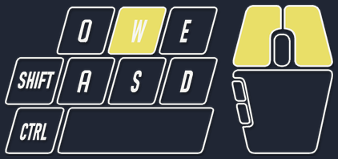
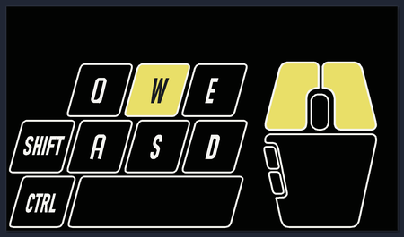

# KeyMouse Overlay —— 按 SVG 设计稿渲染的键鼠显示



透明浮层版的键鼠显示：**形状、圆角、字重、鼠标轮廓全部来自 `keyboard-mouse.svg`**，  
程序直接解析 SVG 路径（含贝塞尔曲线、圆角、字形路径、transform 矩阵）再栅格化，  
不是照着图猜坐标。**不需要 OBS，也不需要 NohBoard**。

加 `--bg` 就是设计稿里那张黑底卡片：



> **不想装 Python？** 直接下打包好的免安装版：
> [**KeyOverlay.exe**](https://github.com/he283/KeyOverlay/releases/latest/download/KeyOverlay.exe)（Win10/11，单文件，自带运行时）
>
> ⚠️ 游戏是**以管理员身份运行**的话，这个 exe **也必须以管理员身份运行**，否则浮层看不见、按键不亮 →
> 见「[进游戏后浮层看不见 / 按键不亮？](#进游戏后浮层看不见--按键不亮)」。

## 怎么做到的

`keyoverlay.py` 里有一个小型 SVG 解析器，只做四件事：

1. 递归遍历 `<g>`，继承 `fill / stroke / stroke-width`，累积 `transform`；
2. 把 `M L H V Q C Z`（含相对指令）展平成折线，曲线按 8 段采样；
3. `<rect rx>` 转成圆角多边形；
4. 每个元素单独栅格化并缓存成小贴片，按下时换一份"黄底"版本。

所以以后改设计只要改 SVG，不用动代码。

## 元素 → 按键映射

| SVG id            | 按键      | SVG id                  | 按键       |
| ----------------- | ------- | ----------------------- | -------- |
| `key-q` ~ `key-e` | Q W E   | `key-a` ~ `key-d`       | A S D    |
| `key-shift`       | 左 Shift | `key-ctrl`              | 左 Ctrl   |
| `key-space`       | 空格      | `mouse-left/right`      | 左/右键     |
| `mouse-wheel`     | 中键      | `mouse-side-front/back` | 侧键 X1/X2 |

字母标签按 `aria-label` 关联到对应按键，按下时转深色。

## 用法

```
双击 start.bat                     # 默认：左下角、1.2 倍、点击穿透、透明底
```

| 参数                                    | 说明                               |
| ------------------------------------- | -------------------------------- |
| `--layout classic`                    | 换成原版 9 键布局（默认 `extended` = 25 键） |
| `--scale 1.2`                         | 整体缩放（1.0 时约 420×186）             |
| `--bg`                                | 连 SVG 的黑色底板一起画（就是设计稿那张图）         |
| `--mouse-yellow`                      | 鼠标左右键**常亮**黄色（不要按下反馈时用，更接近设计稿）   |
| `--pos 40,900`                        | 指定左上角坐标；给了就钉死，面板里的格位不再生效         |
| `--margin 40`                         | 浮层离屏幕边缘的距离                       |
| `--solid`                             | 取消点击穿透                           |
| `--preview out.png`                   | 只出图不开窗口，可配 `--pressed W,LMB`、`--layout`、`--move-deg` |
| `--hold 0.03`                         | 按下后**至少点亮**多少秒（默认 0.03）          |
| `--poll 0.006`                        | 轮询间隔（默认 6ms）                     |
| `--debug`                             | 把每次状态变化写进 `keyoverlay.log`，排查连点用 |
| `--no-tray`                           | 不创建系统托盘图标                        |
| `--toggle-vk 0x78` / `--quit-vk 0x7A` | 隐藏/退出热键的虚拟键码                     |

> 命令行的优先级高于 `keyoverlay.ini`：ini 里存的是上次在面板里选的配置，写明参数时以参数为准。

运行中：**F9 显示/隐藏，F10 退出**，也可以从**系统托盘**操作。

> 重复双击 `start.bat` 不会叠出两个浮层：新实例会先让旧实例退出再接管。

### 系统托盘

启动后任务栏右下角会有一个图标（就是程序自己的键盘/鼠标图标）：

| 操作       | 效果                                       |
| -------- | ---------------------------------------- |
| **左键单击** | 显示 / 隐藏浮层                                |
| **左键双击** | 打开控制面板（单击会延迟 0.28s 判定，避免双击顺带切一次显隐）      |
| **右键**   | 菜单：隐藏浮层 / 重新加载设计稿 / **控制面板…** / **浮层位置** / 退出 |

托盘图标的状态会跟着变：悬停提示会显示「显示中」还是「已隐藏」。

「浮层位置」是个九宫格：左上 / 上中 / 右上 / 左中 / 居中 / 右中 / 左下 / 下中 / 右下，
点一下浮层立刻跳过去，边距跟 `--margin` 一致。选择会写进 `keyoverlay.ini`（和 exe 放在一起），
下次启动直接沿用；想恢复初始的左下角，在菜单里重新选「↙ 左下」就行。

### 控制面板

双击托盘图标，或托盘右键 →「控制面板…」。面板是个自绘窗口，点完立刻生效，**不用重启**：

| 分组   | 项                              | 说明                              |
| ---- | ------------------------------ | ------------------------------- |
| 按键布局 | 经典 / 扩展                       | 经典 = 原版 9 键；扩展 = 25 键。切换时浮层会按新尺寸重新贴边 |
| 浮层缩放 | 0.8 / 1.0 / 1.2 / 1.5          | 换尺寸后自动按当前格位重新定位，不会跑到屏幕外         |
| 显示位置 | 九宫格 + 边距 ±                    | 跟托盘菜单里的格位是同一份配置                 |
| 反馈   | 滚轮箭头 / 移动箭头 / 它们的保留时长 / 深色底板 | 时长按 0.05s 一档步进                   |
| 底部   | 显示·隐藏浮层 / 退出程序                 | 「退出程序」是真的退出，关窗口只是收起面板           |

窗口可以按住标题栏拖走，× 只收起面板，进程和浮层都还在。

> 只有「轮询间隔」和「显示/退出热键」留在命令行：前者调大按键会明显漏亮，后者要做按键捕获，
> 都不适合随手改。

**两套布局的差别**

| 布局            | 按键                                          | scale 1.0 尺寸 |
| ------------- | ------------------------------------------- | ------------ |
| `classic`     | Q W E / Shift A S D / Ctrl 空格 + 鼠标（上游原版）     | 505×236      |
| `extended`    | 1-5 / Tab / Q-T / A-G / Z-B / Alt/Ctrl/Space + 鼠标 | 660×346      |

两份设计稿分别是 `keyboard-mouse-classic.svg` 和 `keyboard-mouse.svg`，都在 exe 旁边时优先用外面那份，
方便你直接改图。移动方向箭头的旋转中心是按 `mouse-body` 的包围盒现算的，换布局会自己跟过去。

接了多台显示器时，这个子菜单底部会多出「放在哪个屏幕」，可以指定把浮层放到哪块屏上。
命令行 `--pos x,y` 优先级更高，给了它就不读配置文件。

> **Windows 11 会把新图标默认收进 `^` 折叠区**，看不到就点一下 `^`，  
> 把它**拖到**任务栏上，以后就一直显示了。这是系统行为，程序没法自己把它"钉"出来。

「重新加载设计稿」是为改 `keyboard-mouse.svg` 准备的：改完不用重启，点一下就会重新解析 SVG 并重绘。

### 进游戏后浮层看不见 / 按键不亮？

**首要原因：游戏是「以管理员身份运行」的，浮层必须跟它同权限。**

游戏一旦提权运行，它的窗口就处在**高完整性级别**，而普通双击启动的 KeyOverlay 在**中完整性级别**，
Windows 的 UIPI（用户界面特权隔离）会在两者之间竖一道墙，于是同时坏两件事：

| 现象 | 真实原因 |
| --- | --- |
| 浮层整个看不见，像被游戏盖住 / 只在切出游戏时闪一下 | 低权限进程的置顶窗口压不到高权限窗口上面 |
| 浮层看得见，但怎么按都不亮 | 前台是高权限窗口时，输入读不进来 |

两者都是权限不对等造成的，**跟 SVG、缩放、`--hold`、热键统统无关**，调参数是白费功夫。

**解决：让浮层和游戏一样提权。**

1. **一次性**：右键 `KeyOverlay.exe`（`dist\` 里的，或从 Releases 下的那个）→ **以管理员身份运行**。
2. **一劳永逸**：右键 exe → 属性 → **兼容性** → 勾选 **以管理员身份运行此程序** → 确定。以后双击就是管理员。
3. **用源码跑 `start.bat` 的**：它启动的是 `pythonw.exe`，**改 exe 的属性管不到它**，得单独处理——
   右键 `start.bat` 同样勾上兼容性里的"以管理员身份运行"（或右键 → 以管理员身份运行）。
4. 想固定参数就用快捷方式：右键 → 属性 → 快捷方式 → **高级** → 勾选 **用管理员身份运行**。

几点值得知道的：

- **提权一定会弹 UAC**，除非把 UAC 关了（不建议）。这是系统设计，程序绕不过去。
- **浮层提权后照样兼容不提权的游戏**：高权限能覆盖低权限，反过来不行。
  所以懒人做法是「**浮层永远以管理员启动**」，两种情况都覆盖。
- **F9 / F10 提权后仍然有效**：本程序用 `GetAsyncKeyState` 轮询而不是 `RegisterHotKey`，
  不依赖窗口焦点，提权不受影响。
- **别急着给游戏提权**：能不提就不提。游戏本身不需要管理员权限的话，直接普通启动最省事。

**先分清是哪种"不亮"**：

```
KeyOverlay.exe --debug
```

按一下 W，然后看 `keyoverlay.log`：

- **有记录** → 按键读到了，只是浮层被盖住 → 查权限（就是上面这条）或把游戏改成**无边框窗口**。
- **没记录** → 输入根本没进来 → 100% 是权限不对等，提权重启浮层。

顺带一句：如果游戏是**独占全屏**，即便权限一样也看不见（见「已知限制」第 1 条），要切成**无边框窗口**。

### F10 按了没退出？

**旧版本这里是真 bug**：代码里把退出热键写成 `0x7A` 并标成 F10，但 `0x7A` 其实是 **F11**（F10 是 `0x79`）。  
所以以前按 F10 毫无反应、按 F11 才退。现在默认 `F10 和 F11` 都认。

如果还是不行：

1. **笔记本的 F10 可能是多媒体键**，要按 `Fn+F10`。也可以换键：
   ```
   --quit-vk 0x77     F8 退出
   --quit-vk 0x7B     F12 退出
   ```
2. 确认没有多个旧实例 —— **双击 `stop.bat`** 一次清干净（按窗口类名找，不依赖热键）。
3. 确认改的是 `start.bat` 启动的那个进程（不是别的 python 脚本）。

### 连点只闪一下就没了？

点亮时长由 `--hold` 决定（默认 60ms）。`--hold` 越长，两次点击之间的“熄灭间隙”越容易被吃掉。  
所以：

- **想看清楚每一次快速点按** → 调大：`--hold 0.08`
- **想更灵敏、连点分得更开** → 调小：`--hold 0.03`（再小也看不出区别，见下）

实测（按 25ms、间隔 90ms 点两下）：

```
--hold 0.15  -> 一段连续亮灯（看起来只闪一下）
--hold 0.06  -> W 亮 87ms → 灭 29ms → W 亮 87ms
--hold 0.03  -> W 亮 34ms → 灭 81ms → W 亮 49ms（三下连点，三下都清楚分开）
```

注意：一次重绘本身要 ~~30ms，所以 `--hold` 调到 0.03 以下，「亮」的时长基本就卡在 30~~40ms 不再变短，  
只是熄灭间隙更干净。再往下调没有实际收益。

调完可以用 `--debug` 启动，然后 `keyoverlay.log` 里就是每次亮/灭的时间戳，方便对着调。

### 按 F9 没反应？

1. 先确认只剩一个浮层（旧版本可能叠了多个）——结束所有 `pythonw.exe` 再启动。
2. 笔记本的 F9 可能是多媒体键，试 `Fn+F9`，或换键：`--toggle-vk 0x77`（F8）。
3. F9 只是隐藏，进程还在；彻底退出按 **F10**。

### 键盘像被按住 / 滚轮变成缩放？

典型症状：打字全是快捷键效果、全变成大写，或者滚轮一滚页面就放大缩小。  
这是 **Ctrl / Shift / Alt / Win 卡成了"按下"状态**（Ctrl 卡着时，滚轮就是缩放）。

**双击 `release_keys.bat`** 即可——它只补发"抬起"，从不发送"按下"，可以放心双击。

它做两件事：

1. 给全部虚拟键码 + 鼠标按键补发抬起（治系统层的卡键）；
2. **再直接给当前前台窗口投递一遍 `WM_KEYUP`**（治「系统已经松开、但那个程序自己还以为按着」）。

> **为什么需要第 2 步**：按键消息只发给**当时的前台窗口**。如果那个"记着 Ctrl 按着"的程序  
> 在补发抬起时不在前台，它就永远不知道键已经松了——这时 `GetAsyncKeyState` 查起来是干净的，  
> 但你就是打不了字。遇到这种情况，**先点一下出问题的那个窗口让它到前台，再双击一次**。

> 说明：**浮层程序本身只读取按键状态（GetAsyncKeyState），从不注入任何按键**，不会造成卡键。  
> 这种情况通常来自按键注入类脚本被中途杀掉（按下了却没来得及发抬起）、  
> 或者宏软件把某个键卡在持有状态。

## 改设计

- **改形状/字**：直接改 `keyboard-mouse.svg`（Illustrator / Figma / Inkscape 都行），存回原路径即可，程序启动时重新解析。
- **改高亮色**：`keyoverlay.py` 顶部 `HILITE`（默认取自 SVG 黄色渐变的中间色 `#e9df68`）。
- **关掉外发光/投影**：`GLOW = False` / `SHADOW = False`。
- **改整体大小**：`ART_SCALE`（SVG 单位 → 像素，默认 0.34）或直接用 `--scale`。

## 打包成 exe

**现成的不在这里下**——仓库里只有源码，`dist\` 是 `.gitignore` 掉的：
去 [**Releases**](https://github.com/he283/KeyOverlay/releases/latest) 下载 `KeyOverlay.exe`（约 17 MB，单文件），
它自带 Python 和 Pillow，拷到任何 Win10/11 机器上双击就能用，**不需要装 Python**。

- 命令行参数照旧可用：`KeyOverlay.exe --scale 1.0 --pos 40,900`  
  想固定参数就建个快捷方式，在“目标”后面加上。
- 想换设计稿：把改好的 `keyboard-mouse.svg`（扩展布局）或 `keyboard-mouse-classic.svg`（经典布局）
  **放在 exe 同一个目录**，它会优先用这一份（不放就用内嵌的那份）。
- 重新打包：双击 `build_exe.bat`（会自动装 PyInstaller，约 20 秒出结果），产物在本地 `dist\`。

两个实话：

1. **单文件版首次启动约 2.2 秒**——它要先把自己解压到临时目录。嫌慢可以改成目录版  
   （`build_exe.bat` 里把 `--onefile` 去掉），启动约 0.6 秒，但会产出个文件夹。
2. **exe 没有数字签名**，第一次运行 Windows SmartScreen 可能拦一下（“更多信息 → 仍要运行”），  
   个别杀软也会对 PyInstaller 打包的 exe 误报。这是打包方式决定的，不是程序有问题。

## 目录

```
D:\KeyOverlay
├─ keyoverlay.py                主程序（SVG 解析 + Pillow 栅格化 + ctypes 分层窗口 + 自绘控制面板）
├─ keyboard-mouse.svg           扩展布局（25 键）设计稿
├─ keyboard-mouse-classic.svg   经典布局（原版 9 键）设计稿
├─ keyoverlay.ini               运行时生成的配置（面板里改的东西存在这，已在 .gitignore）
├─ dist\KeyOverlay.exe          本地打包产物（不进仓库，发布版见 Releases）
├─ build_exe.bat                重新打包
├─ app.ico                      exe / 托盘图标（多尺寸 256~16）
├─ app_icon_src.png             图标原图
├─ make_icon.py                 用任意图片重新生成 app.ico
├─ start.bat                    一键启动（pythonw，不开黑框）——开发/改代码时用这个
├─ stop.bat / stop.py           一键关掉所有实例（不用热键，也不怕开了多个）
├─ release_keys.bat             键/鼠标卡在"按下"状态时的一键解卡
├─ preview.png                  透明底预览（W + 鼠标左右键按下）
├─ preview_with_bg.png          带黑色底板的样子
├─ io_presets\                  input-overlay 的原始素材（历史对照，程序不用）
└─ README.md
```

## 已知限制

1. **独占全屏游戏里看不到**，游戏要设"无边框窗口"。
2. 用 `GetAsyncKeyState` 轮询（12ms），**不装全局钩子**，对反作弊友好；最快按键会延迟一帧。
3. 状态切换时才重绘（约 30ms，相同状态走缓存），连续快速按键不会卡。
4. 录屏要录**整个屏幕**，别选单窗口，否则浮层录不进去。
5. **游戏以管理员启动时，KeyOverlay.exe 也要以管理员启动**——见上文「[进游戏后浮层看不见 / 按键不亮？](#进游戏后浮层看不见--按键不亮)」，
   这是浮层失效的头号原因。懒人做法：永远给浮层提权，两种情况都兼容。
